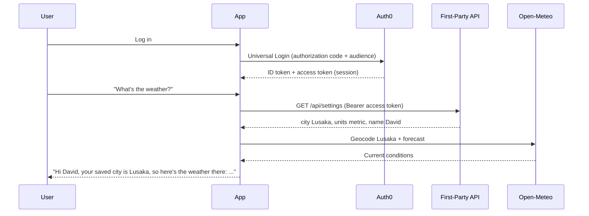

# Context-Preserving Assistant

A small Node.js + Express personal assistant for the [MLH x Auth0](https://www.mlh.com/partners/auth0) challenge **The Context-Preserving Assistant (Full-Stack Identity & API Access)**.

You sign in once with Auth0 Universal Login. The assistant then uses your access token to read your saved settings from a first-party API, and uses those settings to call a third-party weather API. Submission is a link to this code repository.

## How this meets the challenge

1. **Authenticate with Universal Login.** The app uses [`express-openid-connect`](https://github.com/auth0/express-openid-connect) with the authorization code flow. Logging in goes through Auth0 Universal Login. The session holds an ID token and an access token for the first-party API (`audience` = `AUTH0_AUDIENCE`, scope `openid profile email read:settings`). This follows Auth0’s Express quickstart for [calling protected APIs with access tokens](https://auth0.com/docs/quickstart/webapp/express).

2. **Call a first-party API with the user’s ID/token.** `GET /api/settings` and `PUT /api/settings` live on a separate Express router, protected by [`express-oauth2-jwt-bearer`](https://github.com/auth0/node-oauth2-jwt-bearer). The API identifies the user **only** from the verified access token’s `sub` claim. Settings are stored in a local JSON file, with defaults of city `Lusaka` and metric units. The assistant does not read this store directly. It calls the API over HTTP with `Authorization: Bearer <access token>` from the login session.

3. **Call a third-party API within the user’s session.** After the settings lookup, the assistant calls [Open-Meteo](https://open-meteo.com/) (geocoding + forecast) for the user’s saved city. Open-Meteo is a public API with no key and no OAuth, so [Auth0 Token Vault](https://auth0.com/docs/secure/call-apis-on-users-behalf/token-vault) is not required. The call is still made only inside an authenticated session, after the first-party lookup, so the work stays inside the user’s delegated context.

   Token Vault would be the right tool if the third-party API used OAuth, for example Google Calendar. In that extension you would connect Google once, store the Google refresh token in Token Vault, and have the assistant exchange the Auth0 token for a Google access token before calling Calendar. That is left as a possible follow-up, not part of this demo.

**Success criteria.** One conversation, after the initial login, can look like this:

> **You:** What's the weather?
> **Assistant:** Hi David, your saved city is Lusaka, so here's the weather there: Partly cloudy, 24°C, wind 10 km/h, humidity 40%.

Each reply includes a short trace of the APIs that were called (first-party `/api/settings` with your `sub`, and Open-Meteo when the weather is fetched).

## How a weather question flows



## Prerequisites

- Node.js 18 or newer
- An [Auth0](https://auth0.com/) account (a free tenant is enough)

## Set up Auth0

You can reuse an existing Regular Web Application or create a new one.

### 1. Regular Web Application

1. Open the [Auth0 Dashboard](https://manage.auth0.com/).
2. Go to **Applications** → **Applications**. Create a **Regular Web Application**, or open the app you already use.
3. In **Settings**, set these Application URIs and click **Save Changes**:

   | Setting | Value |
   | --- | --- |
   | Allowed Callback URLs | `http://localhost:3000/callback` |
   | Allowed Logout URLs | `http://localhost:3000` |

4. From **Basic Information**, copy the **Domain**, **Client ID**, and **Client Secret**. This app uses the authorization code flow, so the Client Secret is required.

### 2. First-party API

1. Go to **Applications** → **APIs** → **Create API**.
2. Set a name such as `Context Assistant API`.
3. Set the **Identifier** to `https://context-assistant-api` (or another URI you prefer). This value becomes `AUTH0_AUDIENCE` and must match exactly.
4. Leave the signing algorithm as **RS256** and create the API.
5. Open the API’s **Permissions** tab and add:

   | Permission | Description |
   | --- | --- |
   | `read:settings` | Read the signed-in user’s saved settings |

6. Confirm the Regular Web Application can request tokens for this API (in the API’s **Applications** or **Machine to Machine Applications** tab, the app should be authorized if it appears there; for a Regular Web App, requesting the API audience at login is enough once the API exists).

## Environment variables

```bash
cp .env.example .env
```

Edit `.env`:

```bash
# Generate a session secret:
# openssl rand -hex 32
AUTH0_SECRET=paste-the-generated-secret-here
AUTH0_BASE_URL=http://localhost:3000
AUTH0_CLIENT_ID=your-auth0-client-id
AUTH0_CLIENT_SECRET=your-auth0-client-secret
AUTH0_ISSUER_BASE_URL=https://YOUR_AUTH0_DOMAIN
AUTH0_AUDIENCE=https://context-assistant-api
```

`AUTH0_ISSUER_BASE_URL` must include `https://` and use your Auth0 Domain, for example `https://dev-abc123.us.auth0.com`. `AUTH0_AUDIENCE` must be the API Identifier from the step above.

Do not commit `.env`. It is listed in `.gitignore`.

## Run the app

```bash
npm install
npm start
```

Open [http://localhost:3000](http://localhost:3000), click **Log in**, complete Auth0 Universal Login, then open the assistant.

For auto-reload during development:

```bash
npm run dev
```

## Example conversation

After you are logged in, try:

1. **What are my settings?** — The assistant calls `GET /api/settings` with your access token and lists your city and units. New users start with city `Lusaka` and metric units.
2. **What's the weather?** — It reads that saved city from the first-party API, then calls Open-Meteo and answers with the forecast.
3. **Set my city to Nairobi** — It calls `PUT /api/settings` for your token’s `sub`, then confirms the change. Asking for the weather again uses Nairobi.
4. **Set my units to imperial** — Switches the forecast to °F and mph.

You can also say “I’m in Cape Town” or “switch to celsius”.

## Project layout

- `index.js` — Express app, Universal Login, home page, `/chat`, and `POST /assistant`
- `routes/api.js` — First-party settings API, protected with `express-oauth2-jwt-bearer`
- `lib/assistant.js` — Simple intent matching (no LLM and no paid keys)
- `lib/weather.js` — Open-Meteo geocoding and forecast
- `lib/first-party-client.js` — Calls `/api/settings` over HTTP with the session access token
- `lib/settings-store.js` — JSON file store keyed by the token `sub`
- `public/` — Shared dark theme and the chat page script

## Tests

```bash
npm test
```

The tests cover intent matching and assistant replies, a live Open-Meteo request for Lusaka, and a check that `/api/settings` returns `401` without an access token.
